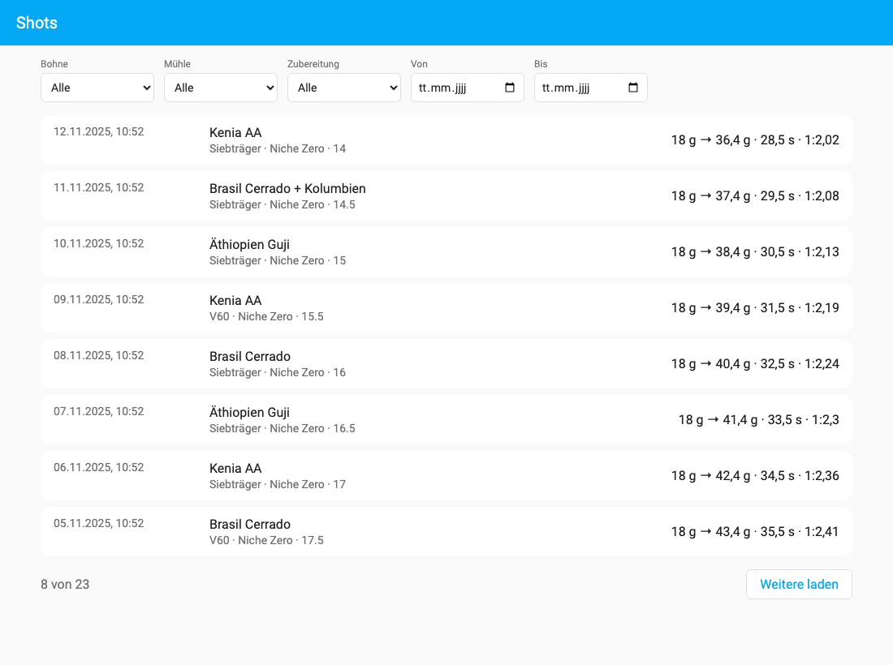
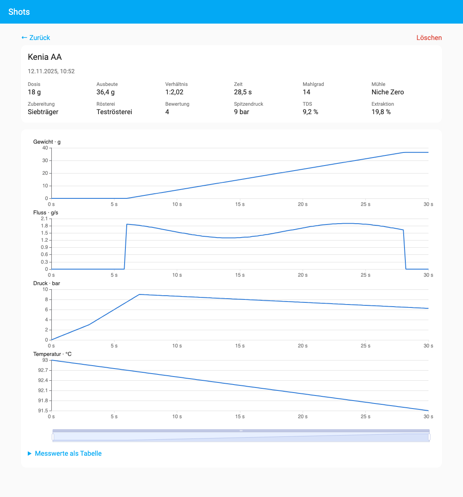

<p align="center">
  <picture>
    <source media="(prefers-color-scheme: dark)" srcset="https://raw.githubusercontent.com/Sedrah87/HASS-CoffeeNerd/main/docs/images/logo-dark.png">
    
  </picture>
</p>

<p align="center">
  <a href="https://my.home-assistant.io/redirect/hacs_repository/?owner=Sedrah87&repository=HASS-CoffeeNerd&category=integration"></a>
</p>

<p align="center">
  <a href="https://hacs.xyz/docs/faq/custom_repositories/"></a>
  
  <a href="https://github.com/Sedrah87/HASS-CoffeeNerd/actions/workflows/validate.yml"></a>
  <a href="LICENSE.md"></a>
</p>

Deine Espresso- und Filter-Shots aus der **CoffeeNørd-App** landen direkt in deinem eigenen
Home Assistant und nicht bei einem Cloud-Dienst. Dort siehst du sie mit Kurven für Gewicht, Fluss,
Druck und Temperatur, kannst sie filtern und für Automationen nutzen.

*Your espresso and filter shots from the CoffeeNørd app, stored in your own Home Assistant with
curves for weight, flow, pressure and temperature. UI in German and English.*

<p align="center">
  
  
</p>
<p align="center"><sub>Beispieldaten. Das Panel folgt dem hellen und dunklen Design von Home Assistant.</sub></p>

## Funktionen

- **Panel „Shots“** in der Seitenleiste: Liste mit Filtern nach Bohne, Mühle, Zubereitung und Zeitraum.
  Die Detailansicht zeigt die Kennzahlen, die Kurven mit gekoppeltem Zoom und Fadenkreuz und die
  Messwerte als Tabelle.
- **Auswertung für den Mahlgrad:** Die App schickt ihre Shot-Auswertung mit: Profil (gleichmäßig,
  ansteigend, langsamer Start, Channeling, viel zu schnell), Fluss in der Hauptphase und den Dritteln,
  erster Tropfen, Pumpenende und den Hinweis zum Mahlgrad. Erster Tropfen und Pumpenende erscheinen
  als Linien in den Kurven, die Liste lässt sich nach Profil filtern.
- **Alte Brews mitnehmen:** Die App lädt auf Wunsch die ganze Historie hoch, auch Brews ohne Kurven.
  Mehrfaches Hochladen erzeugt keine Duplikate, ein bearbeiteter Brew wird aktualisiert.
- **Blend-Shots** mit zwei Bohnen und **zwei Waagen** werden unterstützt.
- **Sensor „Letzter Shot“** mit den Kennzahlen als Attribute, z. B. fürs Dashboard.
- **Event `coffeenord_shot_received`** für Automationen, z. B. die Maschine nach dem Shot in den
  Standby schicken.
- **Alles bleibt lokal:** Die Shots liegen in einer SQLite-Datenbank in deinem HASS-Konfigurationsordner.

## Voraussetzungen

- Home Assistant 2026.10 oder neuer
- [HACS](https://hacs.xyz) für die einfache Installation (optional)
- Die CoffeeNørd-App mit Home-Assistant-Anbindung

## Installation

### Über HACS (empfohlen)

[](https://my.home-assistant.io/redirect/hacs_repository/?owner=Sedrah87&repository=HASS-CoffeeNerd&category=integration)

Der Button öffnet CoffeeNørd in deinem HACS. Kennt HACS das Repository noch nicht, fragt es, ob es als
benutzerdefiniertes Repository hinzugefügt werden soll. Danach *Herunterladen* wählen und Home Assistant
neu starten.

CoffeeNørd steht nicht in der HACS-Standardliste, weil die Lizenz nichtkommerziell ist. Ohne den Button
geht es so:

1. HACS öffnen → ⋮ oben rechts → **Benutzerdefinierte Repositories**.
2. `https://github.com/Sedrah87/HASS-CoffeeNerd` eintragen, Typ **Integration**, hinzufügen.
3. **CoffeeNørd** suchen, herunterladen und Home Assistant neu starten.

### Manuell

Den Ordner `custom_components/coffeenord` in den Ordner `custom_components` deiner HASS-Konfiguration
kopieren und Home Assistant neu starten.

## Einrichtung

1. **Integration hinzufügen:** *Einstellungen → Geräte & Dienste → Integration hinzufügen → CoffeeNørd*.
   Es gibt nichts einzugeben. Danach erscheint „Shots“ in der Seitenleiste (nur für Admins).

   [](https://my.home-assistant.io/redirect/config_flow_start/?domain=coffeenord)
2. **Token erstellen:** In Home Assistant unten links auf dein Profil → *Sicherheit* →
   *Langlebige Zugangs-Token* → *Token erstellen*. Den Token kopieren, er wird nur einmal angezeigt.

   [](https://my.home-assistant.io/redirect/profile_security/)
3. **App verbinden:** In der CoffeeNørd-App unter *Einstellungen → Home Assistant* die Adresse deiner
   Instanz (z. B. `http://homeassistant.local:8123`) und den Token eintragen, mit *Verbindung testen*
   prüfen und **Shots nach Home Assistant hochladen** einschalten.
4. **Historie übernehmen (optional):** Mit *Alle Brews nach Home Assistant hochladen* überträgt die App
   auch deine bisherigen Brews.

Neue und bearbeitete Brews lädt die App danach beim Speichern automatisch hoch.

## Sensor und Event

Der Sensor **Letzter Shot** (Gerät *CoffeeNørd*) zeigt den Zeitpunkt des zuletzt gebrühten Shots.
Bohne, Mühle, Zubereitung, Dosis, Ausbeute, Zeit, Verhältnis, Mahlgrad, Spitzendruck, Profil
(`shape`), Fluss der Hauptphase (`main_flow`) und der Hinweis zum Mahlgrad (`grind_hint`) stehen als
Attribute dabei.

Das Event `coffeenord_shot_received` kommt nur bei **neuen** Shots, die höchstens eine Stunde alt sind.
Beim Hochladen der Historie oder beim Bearbeiten eines Shots kommt es also nicht. Beispiel:

```yaml
automation:
  - alias: "Siebträger nach dem Shot in den Standby"
    triggers:
      - trigger: event
        event_type: coffeenord_shot_received
        event_data:
          preparation_style: ESPRESSO
    actions:
      - delay: "00:15:00"
      - action: switch.turn_off
        target:
          entity_id: switch.espressomaschine
```

Im Event stehen `shot_id`, `brewed_at`, `bean_name`, `bean2_name`, `mill_name`, `preparation_name`,
`preparation_style`, `grind_size`, `dose_g`, `yield_g`, `brew_time_s`, `ratio`, `peak_pressure`,
`shape`, `main_flow` und `grind_hint`. Den Hinweis zum Mahlgrad kannst du dir so z. B. nach jedem Shot
aufs Handy schicken:

```yaml
automation:
  - alias: "Mahlgrad-Hinweis nach dem Shot"
    triggers:
      - trigger: event
        event_type: coffeenord_shot_received
    conditions:
      - condition: template
        value_template: "{{ trigger.event.data.grind_hint is not none }}"
    actions:
      - action: notify.mobile_app_mein_handy
        data:
          title: "{{ trigger.event.data.bean_name }}"
          message: "{{ trigger.event.data.grind_hint }}"
```

## Schnittstelle

Die App spricht mit zwei Endpunkten. Angemeldet wird mit einem Long-Lived Token als
`Authorization: Bearer …`:

| Endpunkt | Inhalt |
|---|---|
| `POST /api/coffeenord/shots` | ein Shot |
| `POST /api/coffeenord/shots/batch` | `{"shots": [...]}`, höchstens 20 pro Aufruf |

Ein Shot ist ein Umschlag um das Visualizer-JSON der App. Der Schlüssel ist die Brew-UUID:

```json
{
  "schema_version": 1,
  "shot_id": "3f1c2a4e-…",
  "brewed_at": 1762941151,
  "updated_at": 1762941300,
  "visualizer": { "bean": {}, "brew": {}, "mill": {}, "preparation": {}, "brewFlow": {} },
  "bean2": { "name": "…" },
  "analysis": { "shape": "SLOW_START", "main_flow": 1.11, "first_drip_s": 5.4, "end_s": 34.1,
                "grind_hint": "Zu langsam …" }
}
```

`analysis` ist optional. Die Integration zeigt die Werte nur an und rechnet selbst nichts aus.

Die Antwort ist `created`, `updated` oder `unchanged`. `unchanged` heißt: Der Stand ist älter als der
gespeicherte, oder er ist gleich alt und die Daten sind identisch. Bei gleichem `updated_at` mit
anderen Daten (z. B. weil die App jetzt die Auswertung mitschickt) wird der Shot aktualisiert. Ein Shot darf höchstens 2 MB groß sein. Ausprobieren ohne App:

```sh
curl -X POST "http://homeassistant.local:8123/api/coffeenord/shots" \
  -H "Authorization: Bearer $HASS_TOKEN" -H "Content-Type: application/json" \
  -d '{"schema_version": 1, "shot_id": "test-1", "brewed_at": 1762941151,
       "visualizer": {"bean": {"name": "Testbohne"}, "brew": {"grind_weight": 18,
       "brew_beverage_quantity": 36, "brew_time": 28}}}'
```

Mehr Details stehen in [docs/plan-backend.md](docs/plan-backend.md).

## Daten und Datenschutz

Die Shots liegen in `<config>/coffeenord/shots.db` und sind in den HASS-Backups enthalten. Die
Integration baut keine Verbindung nach außen auf. Wenn du die Integration entfernst, bleibt die
Datenbank erhalten. Löschen musst du sie selbst.

## Mitmachen

Fehler und Wünsche bitte als [Issue](https://github.com/Sedrah87/HASS-CoffeeNerd/issues) melden.
Das GitHub-Repo ist ein Spiegel, Pull Requests lassen sich dort nicht direkt übernehmen.

<details>
<summary>Entwicklung</summary>

```sh
uv venv --python 3.14 .venv
uv pip install --python .venv/bin/python -r requirements_test.txt
.venv/bin/ruff check . && .venv/bin/pytest
git config core.hooksPath .githooks   # Privatsphäre-Prüfung vor Commit und Push
```

Das Panel liegt in `frontend/` (TypeScript, Lit, ECharts). Das gebaute Bundle wird eingecheckt, weil
HACS nur `custom_components/` installiert:

```sh
cd frontend && npm ci && npm run check   # Typen, Lint, Build, Lizenzprüfung
```

`npm run check` schreibt `custom_components/coffeenord/frontend/coffeenord-panel.js` und die
Lizenzhinweise der gebündelten Pakete (`THIRD_PARTY_NOTICES.md`). Beides gehört in den Commit.
Die Quellen für Icon und Logo liegen in `docs/branding/`.

</details>

## Lizenz

[PolyForm Noncommercial 1.0.0](LICENSE.md): Die Integration darf frei genutzt, verändert und
weitergegeben werden, aber nicht kommerziell. Das Panel enthält Lit (BSD-3-Clause) und Apache ECharts
(Apache-2.0). Ihre Lizenztexte stehen in
[THIRD_PARTY_NOTICES.md](custom_components/coffeenord/frontend/THIRD_PARTY_NOTICES.md).

CoffeeNørd ist ein eigenständiges Projekt und gehört weder zu Home Assistant noch zu visualizer.coffee.
